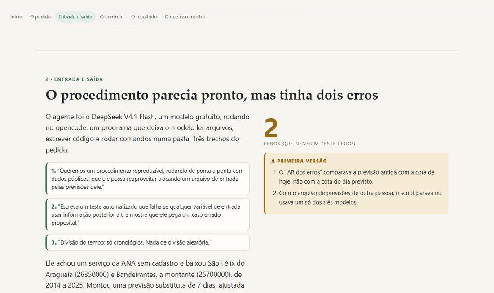

# Do formulário à comparação de correções — Araguaia

**Correção dos erros de previsão de cota em 7 dias (São Félix do Araguaia) com métodos tradicionais e aprendizado de máquina, sem vazar o futuro.**

Encontro individual do Estágio Docência · LAPIG/UFG · 03/11/2026.

- **Ver a página:** <https://victorgit10.github.io/mauro-araguaia/>
- **Repositório:** <https://github.com/VictorGit10/mauro-araguaia>



## O que tem aqui

- **`index.html`**: a página do encontro. Começa pela resposta ao formulário e mostra o que a IA generativa fez com ela: a entrada, a primeira saída, os controles, o resultado e o que isso mostra. Funciona offline (imagens embutidas).
- **O pacote** (`codigo/`, `dados/`, `figuras/`, `RELATORIO.md`, `REFERENCIAS.md`): o trabalho completo, executado de ponta a ponta. Todos os números saem dos scripts. Instruções abaixo.
- **`CLAUDE.md` e `AGENTS.md`**: o contexto para a IA que for continuar o trabalho.
- **`docs/revisoes/`**: o caminho do trabalho, para quem quiser auditar: o formulário (`CONTEXTO.md`), o pedido dado ao agente (`PEDIDO.md`, `REGRAS-COMUNS.md`), as correções pedidas (`CORRECOES*.md`) e a conferência independente de outro modelo (`CONFERENCIA-MINIMAX.md`).

## Como foi feito

1. O formulário virou um pedido escrito para um agente de IA (DeepSeek V4.1 Flash, no opencode), com regras: dados públicos, todo número saindo de script, controle em cada conclusão, referência só com DOI conferido.
2. O agente executou tudo. Claude conferiu (testes, números, DOIs) e pediu correções.
3. Outros modelos revisaram sem poder alterar nada (MiniMax M3.1 e Gemini Argon). Cada afirmação deles foi conferida no código antes de corrigir.
4. A página foi redigida pelo Gemini 3.8 a partir de um briefing com os fatos conferidos, e revisada.

Os dados brutos da ANA já estão no repositório (`dados/bruto/`), e os scripts baixam de novo se for preciso. Nada aqui exige cadastro ou chave de acesso.

## Continuar com uma IA

O repositório foi organizado para um assistente ler. Cole o link no Claude, ChatGPT, Gemini ou Codex e peça, por exemplo: "Explique a estrutura deste repositório e como rodar o pacote", ou "Adapte o procedimento para os meus dados". O `CLAUDE.md` traz o contexto, as armadilhas e a ordem dos scripts.

## Licença

Texto, página e figuras: CC BY 4.0. Código em `codigo/`: MIT. Detalhes em `LICENSE`.

---

# O pacote

## Correção dos erros de previsão de nível em 7 dias — procedimento reproduzível

Este pacote monta, roda e avalia a comparação entre **previsão original** e **previsões corrigidas** (persistência do erro, AR dos erros, filtro de Kalman e aprendizado de máquina) para a cota do rio Araguaia, com **dados públicos** e **sem usar informação futura**.

> **Aviso:** as previsões usadas aqui **não são as suas**. São um substituto (regressão cota-cota ajustada em 2014–2021) para o procedimento rodar de ponta a ponta. Troque o arquivo pelas previsões dos seus modelos.

## 1. Dados

| Papel | Estação | Código ANA | Rio | Período |
|---|---|---|---|---|
| Alvo | São Félix do Araguaia (MT) | 26350000 | Araguaia | 2014-01-01 a 2025-12-31 |
| Montante | Bandeirantes (Nova Crixás-GO) | 25700000 | Araguaia | 2014-01-01 a 2025-12-31 |

- **Nível:** webservice SOAP antigo da ANA (`telemetriaws1.ana.gov.br/ServiceANA.asmx`, método `DadosHidrometeorologicos`), sem cadastro. Dados de 15 min agregados em média diária (cm → m). São 4.383 dias, 4.217 com nível válido no alvo e 4.152 na montante.
- **Chuva:** média de 8 pontos da bacia a montante, do arquivo público do Open-Meteo, **modelo fixo `era5`** (~30 km). Sem o parâmetro `models`, a API entrega o "Best Match" (ERA5 até 2016, IFS depois), o que quebra a homogeneidade. **Não é o MERGE.**
- **Ablação da chuva:** trocar ERA5 fixo por Best Match muda a chuva em 2.211 dias (média anual 1.355 vs 1.380 mm), mas quase não muda as métricas: RF 0,162 → 0,156 m e HGB 0,173 → 0,160 m; os métodos que não usam chuva ficam idênticos. Fonte: `codigo/10_ablation_chuva.py`.

Por que São Félix: Aruanã foi testada primeiro, mas o P90 do treino é 4,92 m e as máximas de 2024 e 2025 foram 4,90 m e 4,57 m, com zero dias acima do P90 (`codigo/09_aruana.py`). Sem cheia no teste, a pergunta central não teria resposta.

## 2. Como rodar

Precisa de Python 3.10+ com `pandas`, `numpy`, `scikit-learn`, `matplotlib`, `requests`, `lxml`.

```bash
pip install -r codigo/requirements.txt

python codigo/01_baixar_dados.py        # 12 anos x 2 estações (~2,4 MB comprimido)
python codigo/02_chuva_bacia.py         # chuva ERA5 fixa (8 pontos)
python codigo/03_montar_series.py       # dados/series_diarias.csv
python codigo/04_previsao_referencia.py # previsão substituta (ajuste só no treino)
python codigo/05_correcoes.py           # um sistema por valor de `modelo`
python codigo/06_avaliacao.py           # métricas, bootstrap pareado, figura
python codigo/07_referencias.py         # confere os DOIs no Crossref
python codigo/08_resumo_dados.py        # auditoria dos dados
python codigo/09_aruana.py              # por que Aruanã foi descartada
python codigo/10_ablation_chuva.py      # ERA5 fixo vs Best Match
python codigo/test_vazamento.py         # vazamento de futuro
python codigo/test_multimodelo.py       # 1 e 3 modelos de ponta a ponta
```

Se você já tem a chuva do MERGE processada:

```bash
python codigo/03_montar_series.py --chuva caminho/merge.csv
```

O CSV precisa de `data` (AAAA-MM-DD) e `chuva_bacia_mm` (mm/dia, média da bacia a montante). Dias faltantes são preenchidos com 0 e o script avisa quantos.

## 3. O que cada script faz

| Script | Função |
|---|---|
| `01_baixar_dados.py` | Telemetria de 15 min das duas estações em `dados/bruto/`. |
| `02_chuva_bacia.py` | Chuva diária de 8 pontos, modelo ERA5 fixo. |
| `03_montar_series.py` | Agrega para o dia, trata falhas curtas, aceita chuva externa. |
| `04_previsao_referencia.py` | Ajusta o cota-cota só em 2014–2021 e gera as previsões de 7 dias. |
| `05_correcoes.py` | Um sistema por `modelo`: features, erros, AR, Kalman, RF, HGB, corretor enxuto, walk-forward. |
| `06_avaliacao.py` | Métricas por modelo e subconjunto, bootstrap pareado, figura. |
| `07_referencias.py` | Confere os DOIs no Crossref. |
| `08_resumo_dados.py` | Auditoria da série (válidos, lacunas, tamanho). |
| `09_aruana.py` | P90 e máximas de Aruanã (justifica o descarte). |
| `10_ablation_chuva.py` | Compara ERA5 fixo com o Best Match na mesma amostra. |
| `features.py` | Variáveis de entrada; só usam dados até `t`. |
| `test_vazamento.py` | Perturba o futuro e confere a definição de e7/e14/e21/e28. |
| `test_multimodelo.py` | Roda 05 com 1 e com 3 modelos, inclusive treino curto. |

## 4. Colocar as suas previsões no lugar

Gere **um CSV por modelo** (recomendado) com as colunas:

```csv
data_emissao,data_alvo,previsao
2015-01-01,2015-01-08,4.812
2015-01-02,2015-01-09,4.790
```

- `data_emissao`: dia da emissão; `data_alvo`: dia previsto; `previsao`: cota em **metros**, no mesmo datum da série.
- O horizonte deve ser constante (aqui, 7 dias).
- Para comparar vários modelos de uma vez, acrescente a coluna `modelo`. **Cada valor de `modelo` é um sistema independente**: as correções, o Kalman e as métricas são feitos separadamente, e um modelo não empresta erro para o outro.
- Sem `modelo`, tudo vira um sistema chamado `informado`.

```bash
python codigo/05_correcoes.py --previsao caminho/suas_previsoes.csv
python codigo/06_avaliacao.py
```

**Treino mínimo:** AR, Random Forest, HGB e o corretor enxuto exigem **200 linhas de treino** (até 2021). Abaixo disso, o sistema fica só com persistência e Kalman, e o script avisa. Se você só tem previsões de 2024–2025, não há como treinar o corretor: gere previsões retrospectivas desde pelo menos 2014.

## 5. Aplicar ao modelo do doutorado

1. **Um modelo de cada vez.** Rode o 05 para o cota-cota, depois para a regressão, depois para o RF, salvando em pastas diferentes com `--saida`. Cada um tem seu próprio viés e seu próprio histórico de erros.
2. **Antecedência diferente de 7 dias.** O código está fixo em 7. Para mudar para `H`, ajuste: `HORIZONTE` em `features.py`; o alvo (`data_alvo = t + H`); as defasagens dos erros em `construir_linha` e em `FEATURES_AR` (as mais recentes precisam ser ≥ `H`); e a regra do erro, que vira **`e1 = observado(t) − previsão(t−H)`** — o erro mais recente conhecido em `t` é sempre o da emissão `t−H`.
3. **Chuva.** Troque a coluna `chuva_bacia_mm` pelo MERGE processado (`--chuva`). As janelas atuais são dias 0–2, 3–6, 7–14, 15–29 e 30–59 antes de `t`; renomeie se mudar os cortes.
4. **Corrigir um modelo que já é aprendizado de máquina** (o seu RF) ou que já usa cota de montante e chuva: o corretor só tem informação nova nos **erros já verificados** e na **atualização no tempo**. Não espere o mesmo ganho do caso cota-cota. Testamos um **corretor enxuto** (só `e7`, `e14` e variação recente da cota): habilidade 0,093 (IC −0,024 a 0,220), contra 0,114 do RF completo (IC −0,173 a 0,336) — os dois estatisticamente indistintos de zero e ambos abaixo do Kalman (0,415). Ou seja: para um modelo já rico em entradas, o ganho tende a vir mais de **corrigir o viés** do que de um novo modelo de erro.

## 6. Decisões metodológicas (valide antes de usar no artigo)

1. **Divisão só cronológica:** treino 2014–2021, validação 2022–2023, teste 2024–2025. Nunca aleatória: dias vizinhos são quase idênticos e um sorteio colocaria o mesmo evento nos dois lados.
2. **A regra do erro verificado:** na emissão `t`, o erro mais recente conhecido é o da previsão emitida em `t−7`, com alvo `t`. Os erros `e14`, `e21` e `e28` são os das emissões `t−14`, `t−21` e `t−28`, verificados em `t−7`, `t−14` e `t−21`. O erro do alvo `t+7` é o alvo e **não** entra como variável.
3. **Cheia:** cota observada ≥ **P90 do treino = 6,97 m**. É uma definição estatística, não a cota de alerta oficial do SGB.
4. **Horizonte fixo de 7 dias.**
5. **Convenção de tempo:** a emissão em `t` é feita ao **fim do dia `t`**. Se o seu modelo emite de manhã, ele só conhece até `t−1`; desloque as variáveis em um dia.
6. **Métricas:** RMSE, MAE, viés e habilidade `1 − MSE_método/MSE_original`. Os intervalos agora são da **diferença pareada** entre métodos, com bootstrap em blocos de 30 dias (geral) e **7 dias** (cheia), 2.000 reamostragens.
7. **Dois modos de ajuste:** treino fixo (2014–2021) e **walk-forward** (refit a cada 1º de janeiro).

## 7. Resultados (teste 2024–2025)

**Sistema principal cota-cota:** 584 emissões no teste, **528 na amostra comum** a todos os métodos, **31 dias de cheia**. A cheia de 2025 é um único evento de 50 dias (19/01–09/03); a amostra corrigida cobre a **subida e o pico** (31 dias, até 18/02) e os **19 dias de descida** (19/02–09/03) ficaram fora por falha da estação a montante.

| Método | RMSE (m) | MAE (m) | Viés (m) | Habilidade |
|---|---|---|---|---|
| Previsão original | 0,172 | 0,132 | +0,113 | 0,000 |
| Persistência do erro | 0,180 | 0,113 | 0,000 | −0,092 |
| AR dos erros (lag ≥ 7) | 0,172 | 0,132 | +0,113 | 0,005 |
| **Kalman no viés** | **0,132** | **0,086** | +0,013 | **0,415** |
| Random Forest | 0,162 | 0,115 | +0,102 | 0,114 |
| Gradient boosting | 0,173 | 0,127 | +0,112 | −0,012 |
| Corretor enxuto (RF) | 0,164 | 0,118 | +0,101 | 0,093 |

Na cheia (31 dias, subida e pico):

| Método | RMSE (m) | Viés (m) | Habilidade |
|---|---|---|---|
| Previsão original | 0,360 | +0,262 | 0,000 |
| Kalman | **0,280** | +0,117 | **0,396** |
| Random Forest | 0,300 | +0,205 | 0,307 |
| Gradient boosting | 0,324 | +0,268 | 0,193 |
| Corretor enxuto | 0,334 | +0,261 | 0,141 |

**A IA dá ganho adicional?** Sobre a original, o RF tem ganho pontual de 0,114 de habilidade (diferença pareada +0,105), mas o IC95 cruza zero (−0,173 a 0,336). Contra o Kalman, no ajuste fixo, o RF é **pior** de forma significativa (diferença −0,316; IC −0,650 a −0,023), e o HGB também (−0,446; IC −0,854 a −0,097). **No walk-forward, porém, a diferença RF − Kalman cai para −0,139 (IC −0,382 a +0,111) e os dois não se separam.** Ou seja: o Kalman é o mais hábil, mas a vantagem sobre o RF depende do regime de ajuste. O Kalman do walk-forward é idêntico ao fixo por construção (filtro causal, sem treino).

Na cheia, o RF supera a original (diferença +0,343; IC 0,200 a 0,645), mas continua atrás do Kalman (−0,110; IC −0,349 a −0,012). É **um evento** — ver os limites.

Tabelas completas: `dados/metricas.csv`, `dados/bootstrap_diferencas.csv`, `dados/metricas_walkforward.csv`, `dados/kalman_sensibilidade.csv`. Figura: `figuras/serie_teste.png`.

## 8. Armadilhas encontradas

1. **A estação a montante falhou nas cheias.** Em 2025, a estação a montante falhou de 12/02 a 26/03; por isso faltam previsões do cota-cota para alvos de 19/02 a 02/04, e a amostra principal perde a descida. Um modelo de reserva (sem montante) cobre esses dias, mas com apenas 118 linhas de treino — só persistência e Kalman. Nele, **as correções pioram**: RMSE 0,211 → 0,246 (Kalman) em 97 dias, e 0,158 → 0,263 nos 12 dias de cheia. Lição: **não transporte uma correção calibrada em um sistema para outro**.
2. **O erro tem viés, não só ruído.** A previsão substituta tem viés 0,000 no treino, +0,073 na validação e +0,113 no teste. Os modelos ajustados no treino não acompanham essa mudança; o Kalman acompanha.
3. **Poucos eventos de cheia.** Um evento não permite estimar ganho médio em cheias. O bootstrap em blocos de 7 dias ainda tem só ~5 blocos e não representa a variabilidade entre eventos.
4. **O teste de vazamento precisa de um caso errado proposital.** Veja `codigo/test_vazamento.py`.

## 9. Limitações

- A previsão é **substituta**; nada aqui avalia os modelos do pesquisador.
- Chuva de reanálise (ERA5), média de 8 pontos, não a chuva média da bacia com máscara.
- Um evento de cheia, e só a subida/pico na amostra principal.
- Período de teste seco em relação ao treino.
- Correções ajustadas por sistema; o de reserva tem treino curto.
- Sem validação com cotas de alerta oficiais.

## 10. Onde olhar primeiro

- `RELATORIO.md` — números, o que não deu certo e onde a IA ajudou ou não.
- `figuras/serie_teste.png` — observado, original e corrigidas, com a cheia marcada.
- `codigo/test_vazamento.py` — a parte que você disse ser a mais difícil.
- `REFERENCIAS.md` — 9 trabalhos com DOI conferido.

